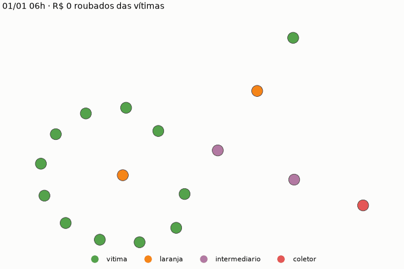
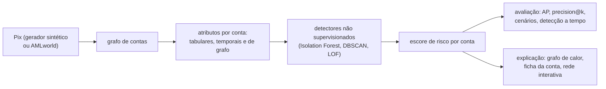
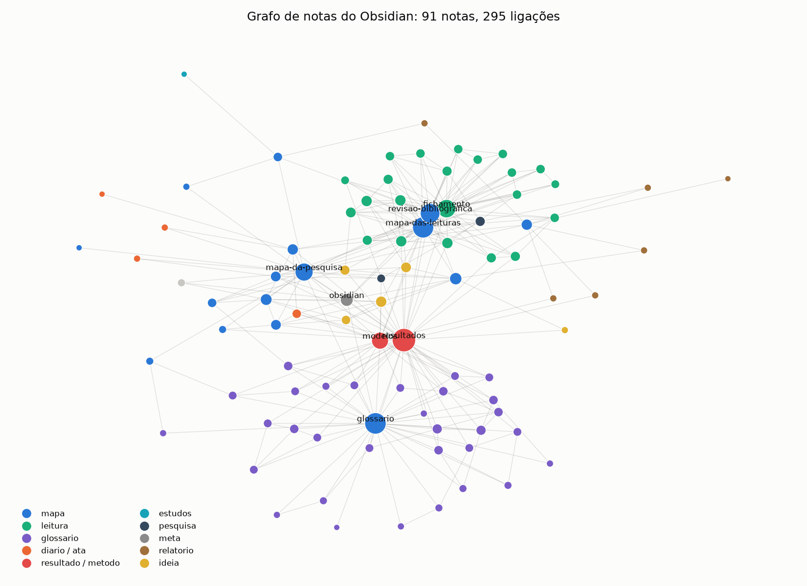
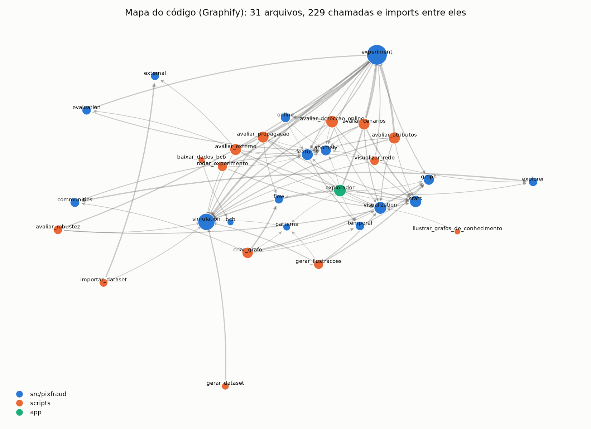

# Detecção de Fraudes em Transações PIX utilizando Teoria dos Grafos e Machine Learning

[](https://github.com/gblsun/deteccao-fraudes-pix-grafos/actions/workflows/testes.yml)

Repositório da pesquisa de iniciação científica que investiga como a teoria dos grafos e
métodos de detecção de anomalias podem identificar e **explicar** fraudes em transações
PIX. As contas são modeladas como vértices e as transferências como arestas. Métricas
estruturais (grau, centralidade, intermediação) alimentam detectores não supervisionados
(Isolation Forest, DBSCAN e LOF), e os resultados são interpretados com grafos de calor e
heatmaps de risco.


*O problema em uma imagem: as contas da quadrilha (laranja, roxo e vermelho) e as vítimas
(verde) estão misturadas ao movimento normal (cinza e azul). O que as denuncia não é o que
cada conta faz sozinha, e sim o formato que elas desenham na rede.*

Texto completo da proposta: [docs/proposta.md](docs/proposta.md) ([PDF original](docs/proposta-original.pdf)).
**Mapa de toda a documentação**: [docs/mapa-da-pesquisa.md](docs/mapa-da-pesquisa.md). Cada pasta tem o seu
README (por exemplo, [scripts/](scripts/mapa-dos-scripts.md) e [reports/](reports/mapa-dos-resultados.md)).

**Para estudar:** a pasta [estudos/](estudos/) tem notebooks sobre teoria dos grafos aplicada
a fraudes no Pix, com exercícios e gabarito, além das ferramentas para criar, recortar,
desenhar e exportar grafos.

## Como o dinheiro se move

A vítima paga uma conta **laranja**, que repassa em minutos para **intermediários** até
chegar à conta **coletora**. Cada quadro é uma hora:



O gerador injeta esses formatos na rede, e são eles que os atributos de grafo tentam
capturar ([`pixfraud.patterns`](src/pixfraud/patterns.py)):


## O caminho da análise



Cada modelo está explicado em [docs/modelos.md](docs/modelos.md); os resultados, em
[docs/resultados.md](docs/resultados.md).

## O que a pesquisa mostrou até aqui


No cenário fácil (`base`), os atributos tabulares parecem bastar. Quando o gerador deixa de
entregar os sinais "de graça" (golpes só de madrugada, contas recém-abertas), a ordem se
inverte: **os atributos de grafo vencem em todas as sementes**, e a combinação de todos é a
mais robusta. Detalhes, ressalvas e as outras análises (detecção a tempo, culpa por
associação, validação no AMLworld) estão em [docs/resultados.md](docs/resultados.md).

## Estrutura

```
├── CLAUDE.md                  instruções para agentes de IA (Claude Code)
├── llms.txt                   resumo e pontos de entrada para qualquer IA
├── graphify-out/              grafo do código (Graphify): graph.json e GRAPH_REPORT.md
├── app/explorador.py          explorador interativo (Streamlit)
├── configs/
│   ├── experimento.yaml       parâmetros da simulação, dos atributos e dos modelos
│   └── cenarios.yaml          cenários de dificuldade (desligam os atalhos do gerador)
├── data/                      dados (não versionados), ver data/README.md
├── docs/
│   ├── proposta.md            proposta da pesquisa (e proposta-original.pdf)
│   ├── cronograma.md          etapas e acompanhamento
│   ├── resultados.md          resultados e interpretação dos experimentos
│   ├── revisao-bibliografica.md  índice das leituras e sugestões
│   ├── referencias.bib        referências em BibTeX
│   ├── obsidian.md            como usar o repositório como cofre do Obsidian
│   ├── leituras/              um fichamento por leitura
│   ├── diario/                diário de pesquisa (uma nota por dia)
│   ├── reunioes/              atas das reuniões de orientação
│   └── modelos/               modelos de fichamento, reunião e diário
├── estudos/                   notebooks de estudo, gabarito e cola de NetworkX
├── notebooks/                 análises exploratórias da pesquisa
├── reports/
│   ├── figures/               grafos de calor, heatmaps de risco, robustez e cenários
│   ├── estudos/               grafos gerados nos estudos (inclui a rede inteira em HTML)
│   └── results/               métricas dos experimentos
├── relatorio/                 esqueleto do relatório final (Markdown + Pandoc)
├── scripts/                   pontos de entrada (ver "Pipeline")
├── src/pixfraud/              código da pesquisa (pacote Python)
│   ├── simulation.py          gerador do dataset sintético de transações PIX
│   ├── bcb.py                 acesso aos dados abertos do PIX (Banco Central)
│   ├── external.py            datasets públicos (AMLworld, PaySim) no formato do projeto
│   ├── graph.py               criação de grafos, trilha do dinheiro, resumo
│   ├── temporal.py            caminhos que respeitam a ordem dos Pix, tempo de permanência
│   ├── communities.py         comunidades (Louvain), k-núcleos, subgrafo denso, OddBall
│   ├── flow.py                fluxo máximo, corte mínimo ("onde bloquear"), propagação de risco
│   ├── algorithms.py          ramificação máxima, caminho gargalo, VF2, HITS, SimRank
│   ├── patterns.py            padrões de fraude (fan-in, cadeia, ciclo...) e injeção
│   ├── features.py            atributos por conta, em conjuntos (tabular, grafo...)
│   ├── anomaly.py             Isolation Forest e DBSCAN
│   ├── evaluation.py          métricas de desempenho
│   ├── stats.py               testes estatísticos, bootstrap, comparações pareadas, modelo nulo
│   ├── experiment.py          núcleo do experimento (uma semente ou várias)
│   ├── online.py              detecção ao longo do tempo: a conta foi bloqueada a tempo?
│   ├── visualization.py       desenho, HTML interativo, Gephi, grafo de calor, heatmap
│   └── explorer.py            página da rede inteira (sigma.js), com filtros e linha do tempo
└── tests/                     testes automatizados (pytest)
```

## Como começar

Requer Python 3.10 ou superior. No PowerShell:

```powershell
python -m venv .venv
.venv\Scripts\Activate.ps1
pip install -e ".[dev,notebooks,app]"
pytest

# opcional: redes neurais para grafos (scripts/avaliar_gnn.py); a versão só para CPU basta
pip install torch --index-url https://download.pytorch.org/whl/cpu
pip install -e ".[gnn]"
```

(No Linux/macOS, ative com `source .venv/bin/activate`.)

## Pipeline

Tudo de uma vez, na ordem certa (dataset, experimento, robustez, cenários, detecção a
tempo, ablação, propagação e AMLworld, se importado):

```powershell
python scripts/reproduzir_tudo.py                                  # completo (algumas horas), reproduz reports/
python scripts/reproduzir_tudo.py --rapido                         # poucas sementes, em reports_teste/: confere que tudo roda
python scripts/reproduzir_tudo.py --etapas dataset experimento     # só algumas etapas
python scripts/reproduzir_tudo.py --extras                         # + rede HTML, ilustrações, grafos e relatório; abre Graphify e Obsidian
python scripts/reproduzir_tudo.py --listar                         # mostra os comandos e o tempo médio de cada etapa, sem rodar
```

Cada etapa mostra o tempo médio antes de começar e, no fim, sai uma tabela com o tempo
de cada uma e o total (ver [scripts/mapa-dos-scripts.md](scripts/mapa-dos-scripts.md)).

Ou passo a passo:

```powershell
# 1. gera o dataset sintético em data/synthetic/ (semente sorteada a cada execução;
#    --seed 42 refaz o dataset dos resultados em reports/)
python scripts/gerar_dataset.py

# 2. monta o grafo, extrai atributos, roda os detectores e salva métricas e figuras
python scripts/rodar_experimento.py

# 3. (opcional) baixa estatísticas públicas do PIX para calibrar o gerador
python scripts/baixar_dados_bcb.py fraudes 202506
python scripts/baixar_dados_bcb.py transacoes 202506 --filtro "AnoMes eq 202506"

# criar grafos avulsos: padrões de fraude, CSVs quaisquer, trilha do dinheiro de uma conta
python scripts/criar_grafo.py padrao mule_ring --saida reports/estudos/anel.png
python scripts/criar_grafo.py csv data/synthetic/transactions.csv --conta C000333 --saltos 5 --direcao tras --saida reports/estudos/trilha.html
```

O formato de saída de `criar_grafo.py` vem da extensão: `.png`/`.svg`/`.pdf`, `.html`
(interativo, abre no navegador) ou `.gexf`/`.graphml` (Gephi). `criar_grafo.py fluxo`
calcula o fluxo máximo e as contas a bloquear entre origens e um destino.

```powershell
# repete o experimento com 10 sementes: médias, intervalos de confiança e testes pareados
python scripts/avaliar_robustez.py --sementes 10

# repete em cada cenário de configs/cenarios.yaml (do mais fácil ao mais difícil)
python scripts/avaliar_cenarios.py --sementes 10

# a rede inteira numa página HTML, com busca, filtros e linha do tempo
python scripts/visualizar_rede.py

# explorador interativo: rede, ficha da conta, padrões, fluxo e resultados
streamlit run app/explorador.py

# validação externa no AMLworld, só com transferências parecidas com o Pix (ver data/README.md)
python scripts/importar_dataset.py amlworld data/raw/HI-Small_Trans.csv --padroes data/raw/HI-Small_Patterns.txt --formatos ACH Wire --saida data/external/amlworld_pix
python scripts/avaliar_externo.py --dados data/external/amlworld_pix --saida reports/amlworld

# detecção ao longo do tempo: quanto do dinheiro roubado seria bloqueado a tempo?
python scripts/avaliar_deteccao_online.py --sementes 3
```

As avaliações longas salvam o progresso: se forem interrompidas, rodar de novo continua
de onde parou.

Todos os parâmetros ficam em [configs/experimento.yaml](configs/experimento.yaml). Com a
mesma configuração e a mesma semente, o resultado é idêntico.

O experimento compara **2 detectores × 6 conjuntos de atributos** (tabular, grafo,
combinado, temporal, grafo avançado e completo) e grava:

- `reports/results/metricas.csv`: precision, recall, F1, ROC-AUC, average precision e
  precision@k de cada combinação;
- `reports/figures/grafo_de_calor_*.png`: as contas mais suspeitas e sua vizinhança,
  coloridas pelo risco;
- `reports/figures/heatmap_risco_*.png`: os atributos que explicam o risco de cada conta
  suspeita.

Um único dataset não basta para afirmar que uma abordagem é melhor: `avaliar_robustez.py`
e `avaliar_cenarios.py` repetem tudo com várias sementes e aplicam testes pareados,
`avaliar_externo.py` testa a mesma configuração num dataset que não fomos nós que geramos
(AMLworld), e `avaliar_deteccao_online.py` mede se a detecção acontece a tempo de bloquear
o dinheiro. Os resultados e sua interpretação estão em [docs/resultados.md](docs/resultados.md).

## Atributos

| Conceito da proposta            | Atributo (`features.py`)                                   | Conjunto |
|---------------------------------|------------------------------------------------------------|----------|
| Grau                            | `in_degree`, `out_degree`                                  | grafo    |
| Centralidade                    | `pagerank` (ponderado pelo valor)                           | grafo    |
| Intermediação (*betweenness*)   | `betweenness`                                              | grafo    |
| Coesão da vizinhança            | `clustering`, `avg_neighbor_degree`                        | grafo    |
| Volume e frequência             | `n_sent`, `n_received`, `amount_sent`, `amount_received`, `max_amount_received` | tabular |
| Repasse rápido (conta laranja)  | `pass_through`                                             | tabular  |
| Comportamento temporal          | `night_ratio`                                              | tabular  |
| Perfil da conta                 | `account_age_days`                                         | tabular  |
| Velocidade de repasse           | `dwell_time_min` (mediana do tempo até o próximo Pix enviado) | temporal |
| Picos de recebimento            | `max_daily_in_degree` (maior nº de pagadores distintos num dia) | temporal |
| Coesão estrutural               | `core_number` (k-núcleo)                                   | grafo avançado |
| Ponte entre comunidades         | `participation` (coeficiente de participação, Louvain)     | grafo avançado |
| Egonet fora do padrão (OddBall) | `oddball_en` (estrela ou quase clique), `oddball_ew` (dinheiro demais para a vizinhança) | grafo avançado |

Os conjuntos (`FEATURE_SETS` em `features.py`) são **tabular**, **grafo**, **combinado**
(tabular + grafo), **temporal**, **grafo_avancado** (grafo + grafo avançado) e
**completo** (todos).

## Dados

O dataset sintético simula contas legítimas (pessoas em círculos de contatos e comércios)
e quadrilhas com contas laranja, intermediários e coletoras, nos cenários de falso
suporte, clonagem de WhatsApp, repasse e lavagem em cadeia. Esquema, cenários e
**limitações conhecidas** do gerador estão em [data/README.md](data/README.md). Leia antes
de interpretar os resultados.

## Ética e LGPD

O projeto não usa dados pessoais reais. Os dados sintéticos não correspondem a pessoas
reais, e os dados do Banco Central são estatísticas agregadas e públicas.

## Grafos de conhecimento: Obsidian e Graphify

A pesquisa tem dois grafos além do grafo de Pix. Um é para **anotar** a pesquisa, o outro é
para **navegar** pelo código, e os dois também servem para agentes de IA:

| | Obsidian | Graphify |
|---|---|---|
| Guarda | o **porquê**: leituras, decisões, reuniões, interpretação dos resultados | o **como**: que função chama qual, o que depende de quê |
| Quem escreve | você, à mão, nas notas `.md` | ninguém: sai da leitura do código (árvore sintática) |
| Nós | notas (fichamentos, glossário, diário, atas, resultados) | arquivos, funções e classes (e os títulos das notas) |
| Arestas | links entre notas | `calls`, `imports`, `uses`, `references` |
| Para a IA | [`docs/grafo-de-notas.json`](docs/grafo-de-notas.json) | `graphify-out/graph.json` e [`GRAPH_REPORT.md`](graphify-out/GRAPH_REPORT.md) |
| Custo | nenhum | nenhum (local, sem LLM) |

### Obsidian: o caderno da pesquisa

O repositório inteiro é um cofre do Obsidian: fichamentos em `docs/leituras/`, termos em
`docs/glossario/`, diário em `docs/diario/`, atas em `docs/reunioes/`, com modelos prontos e
uma cor por tipo de nota. Configuração e rotina em [docs/obsidian.md](docs/obsidian.md).



*Leituras (verde) em volta do mapa das leituras, termos do glossário (roxo) em volta do
glossário, e `resultados.md` e `modelos.md` (vermelho) no meio, ligando os dois.*

O mesmo grafo vai para um JSON que um agente consulta sem abrir as notas uma a uma. Por
exemplo, quem cita a nota do PageRank:

```powershell
python scripts/exportar_grafo_de_notas.py   # depois de criar, renomear ou religar notas
```

```text
docs/glossario/pagerank.md  <-  glossario.md, propagacao-de-risco.md, modelos.md, resultados.md
docs/glossario/pagerank.md  ->  propagacao-de-risco.md, resultados.md, src/pixfraud/features.py
```

### Graphify: o mapa do código

O [Graphify](https://github.com/Graphify-Labs/graphify) lê o código e monta um grafo de
funções, classes e arquivos. Um agente pergunta ao grafo em vez de fazer grep e abrir
arquivos inteiros.



*Cada ponto é um arquivo, e o tamanho é o número de ligações. `experiment.py` e
`simulation.py` são o centro; os scripts (laranja) chamam o pacote (azul).*

```powershell
pip install graphifyy          # no .venv
graphify update .              # depois de mudar o código (local, segundos)
```

**O que quebra se eu mudar `graph_features`?**

```text
> graphify affected "graph_features"
- build_features() [calls] src/pixfraud/features.py:L111
- prepare() [calls] src/pixfraud/experiment.py:L62
- test_features() [calls] tests/test_features.py:L35
- test_pipeline_end_to_end() [calls] tests/test_pipeline.py:L20
- PageRank (ponderado pelo valor) [references] docs/glossario/pagerank.md:L13
- Grau (in_degree, out_degree) [references] docs/glossario/grau.md:L16
  ...
```

Aparecem as funções e os testes que a chamam e também as notas do glossário que citam a
função, ou seja, o que precisa ser revisto junto.

**Como o experimento chega nos atributos de grafo?**

```text
> graphify path "prepare" "graph_features"
prepare() --calls--> build_features() --calls--> graph_features()
```

**Busca única:** `python scripts/buscar.py "propagação de risco"` procura no código e no
texto de todas as notas de uma vez, sem acentos, e lista os `.py` citados nas notas
achadas (ver [docs/obsidian.md](docs/obsidian.md)).

Outros comandos: `graphify explain "propagate_risk"` (vizinhos de uma função),
`graphify god-nodes` (as peças centrais) e `graphify query "..."` (busca por tema).

**Economiza tokens?** Numa medição neste repositório (tokens estimados como bytes ÷ 4), a
pergunta "o que quebra se eu mudar `graph_features`?" custou ~240 tokens pelo grafo,
contra ~3.350 com grep e leitura dos arquivos. A visão geral pelo topo do `GRAPH_REPORT.md`
(resumo, nós centrais e conexões, até `## Communities`) custa ~900 tokens, contra ~41.000
lendo `src/pixfraud/` inteiro. O `.graphifyignore` deixa de fora as notas que não falam do
código (leituras, diário, atas, ideias, modelos de nota e relatório), que já estão no grafo
de notas: o grafo caiu de 1.617 para 1.267 nós e de 111 para 84 comunidades, e o relatório
ficou 23% menor. Numa sessão inteira o ganho
é menor, de uns 20 a 40%, porque para editar uma função o agente ainda precisa ler o
arquivo. O grafo ajuda a descobrir **onde** mexer e **o que** quebra.

As figuras desta seção saem de `python scripts/ilustrar_grafos_de_conhecimento.py`.
O [`CLAUDE.md`](CLAUDE.md) e o [`llms.txt`](llms.txt) apontam os agentes para os dois
grafos, e [docs/obsidian.md](docs/obsidian.md) explica por que Neo4j, GraphRAG, LangGraph
e Memgraph ficaram de fora por enquanto.

## Organização do trabalho

- Etapas e andamento: [docs/cronograma.md](docs/cronograma.md)
- Estudos: [estudos/trilha-de-estudos.md](estudos/trilha-de-estudos.md)
- Leituras: [docs/revisao-bibliografica.md](docs/revisao-bibliografica.md) (índice) e um
  fichamento por leitura em `docs/leituras/`
- Diário de pesquisa: `docs/diario/AAAA-MM-DD.md`, a partir de [docs/modelos/diario.md](docs/modelos/diario.md)
- Reuniões de orientação: `docs/reunioes/AAAA-MM-DD.md`, a partir de [docs/modelos/reuniao.md](docs/modelos/reuniao.md)
- Notas no Obsidian: o repositório já é um cofre configurado, ver [docs/obsidian.md](docs/obsidian.md)
- Relatório final: capítulos em [relatorio/](relatorio/mapa-do-relatorio.md), gerados com
  `python scripts/gerar_relatorio.py`
- Novos notebooks: prefixo numérico e nome descritivo (`02_perfis_de_fraude.ipynb`).
  Código reaproveitável vai para `src/pixfraud/`, com teste em `tests/`.
