# Cronograma

Duração: 12 meses, conforme a proposta ([proposta-original.pdf](proposta-original.pdf)).
Marque `[x]` quando a etapa for concluída.

| Status | Atividade                                                       | Meses   | Entregas no repositório                                   |
|:------:|-----------------------------------------------------------------|:-------:|-----------------------------------------------------------|
| [ ]    | Revisão bibliográfica e fundamentação teórica                   | 1–2     | `estudos/`, `docs/revisao-bibliografica.md`, `docs/referencias.bib` |
| [ ]    | Definição da metodologia e modelagem do problema                | 2–3     | `docs/proposta.md`, `configs/experimento.yaml`            |
| [ ]    | Construção do dataset sintético PIX / seleção de dados públicos | 3–4     | `src/pixfraud/simulation.py`, `src/pixfraud/bcb.py`       |
| [ ]    | Análise exploratória de dados e validação do dataset            | 4–5     | `notebooks/01_analise_exploratoria.ipynb`                 |
| [ ]    | Modelagem das transações em grafos                              | 5–6     | `src/pixfraud/graph.py`                                   |
| [ ]    | Extração de métricas estruturais dos grafos                     | 6–7     | `src/pixfraud/features.py`                                |
| [ ]    | Aplicação de técnicas de machine learning                       | 7–8     | `src/pixfraud/anomaly.py`                                 |
| [ ]    | Desenvolvimento de visualizações em grafos e heatmaps           | 8–9     | `src/pixfraud/visualization.py`, `reports/figures/`       |
| [ ]    | Análise de perfis de fraude e interpretação dos resultados      | 9–10    | notebooks                                                 |
| [ ]    | Comparação entre abordagem tabular e grafos                     | 10–11   | `reports/results/metricas.csv`                            |
| [ ]    | Avaliação dos modelos e métricas de desempenho                  | 11–12   | `src/pixfraud/evaluation.py`, `reports/results/`          |
| [ ]    | Escrita, revisão e finalização do relatório científico          | 11–12   | relatório final                                           |

```mermaid
gantt
    dateFormat X
    axisFormat %s
    section Fundamentação
    Revisão bibliográfica            : 0, 2
    Metodologia e modelagem          : 1, 3
    section Dados
    Dataset sintético / dados BCB    : 2, 4
    Análise exploratória             : 3, 5
    section Grafos e modelos
    Modelagem em grafos              : 4, 6
    Métricas estruturais             : 5, 7
    Machine learning                 : 6, 8
    Visualizações e heatmaps         : 7, 9
    section Análise
    Perfis de fraude                 : 8, 10
    Tabular vs grafos                : 9, 11
    Avaliação dos modelos            : 10, 12
    Relatório final                  : 10, 12
```

