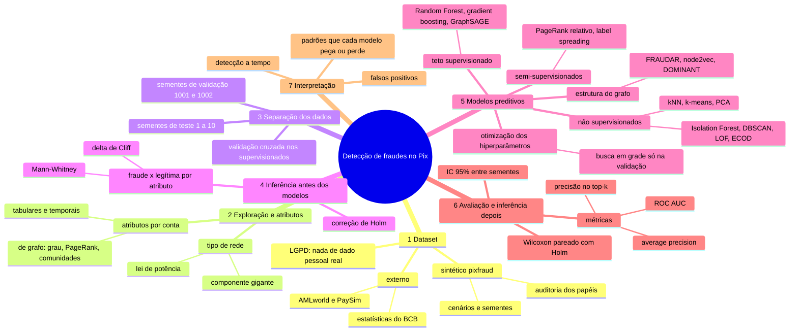
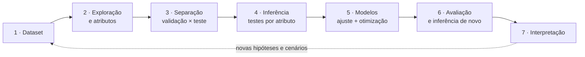

# Fluxo da pesquisa

A ordem em que o trabalho se constrói, do dataset à interpretação. A ideia central é
**dataset → inferência estatística (testes de hipótese) → modelos preditivos (ajuste e
otimização dos hiperparâmetros)**. Em volta dela há quatro cuidados:

- entre o dataset e os testes vêm a análise exploratória e os atributos;
- a separação dos dados vem **antes** dos testes, para nada do teste vazar para a escolha
  de atributos;
- a inferência aparece **duas vezes**: antes dos modelos (quais atributos separam fraude de
  legítima) e depois deles (que modelo é melhor, com intervalo de confiança);
- parte dos modelos é não supervisionada, então a etapa se chama "ajuste e otimização", e
  não só "treinamento".

## Mapa mental

## A ordem das etapas

A seta pontilhada é o ciclo da pesquisa: o que a interpretação mostra (por exemplo, os
comércios no topo do risco) vira cenário novo no gerador e volta ao começo.

## Cada etapa no projeto

| Etapa | O que responde | Onde está | Termos |
|-------|----------------|-----------|--------|
| 1. Dataset | que rede Pix estudar, com que fraudes | [`gerar_dataset.py`](../scripts/gerar_dataset.py), [`auditar_papeis.py`](../scripts/auditar_papeis.py), [`importar_dataset.py`](../scripts/importar_dataset.py), [`baixar_dados_bcb.py`](../scripts/baixar_dados_bcb.py), [`configs/cenarios.yaml`](../configs/cenarios.yaml) | [semente](glossario/semente.md), [conta laranja](glossario/conta-laranja.md), [MED](glossario/med.md) |
| 2. Exploração e atributos | que forma a rede tem e o que se mede de cada conta | [`analisar_tipo_de_rede.py`](../scripts/analisar_tipo_de_rede.py), [`features.py`](../src/pixfraud/features.py), [`graph.py`](../src/pixfraud/graph.py) | [grau](glossario/grau.md), [PageRank](glossario/pagerank.md), [componente gigante](glossario/componente-gigante.md), [comunidades](glossario/comunidades-e-modularidade.md) |
| 3. Separação | o que é ajuste e o que é prova | sementes de validação em [`otimizar_hiperparametros.py`](../scripts/otimizar_hiperparametros.py); sementes de teste nos `avaliar_*.py` | [validação cruzada](glossario/validacao-cruzada.md) |
| 4. Inferência antes | que atributos diferem entre fraude e legítima | `compare_groups` em [`stats.py`](../src/pixfraud/stats.py), usado por [`avaliar_cenarios.py`](../scripts/avaliar_cenarios.py) | [Mann-Whitney](glossario/mann-whitney.md), [delta de Cliff](glossario/delta-de-cliff.md), [correção de Holm](glossario/correcao-de-holm.md) |
| 5. Modelos | que contas são mais suspeitas | [`models/`](../src/pixfraud/models/), [`experiment.py`](../src/pixfraud/experiment.py), [`tuning/`](../src/pixfraud/tuning/), [`otimizar_hiperparametros.py`](../scripts/otimizar_hiperparametros.py) | [supervisionado e não supervisionado](glossario/supervisionado-e-nao-supervisionado.md), [otimização de hiperparâmetros](glossario/otimizacao-de-hiperparametros.md) |
| 6. Avaliação e inferência depois | que modelo é melhor, e com que certeza | [`avaliar_modelos.py`](../scripts/avaliar_modelos.py), [`avaliar_robustez.py`](../scripts/avaliar_robustez.py), `compare_runs` em [`stats.py`](../src/pixfraud/stats.py) | [average precision](glossario/average-precision.md), [precision@k](glossario/precision-at-k.md), [IC](glossario/intervalo-de-confianca.md), [Wilcoxon pareado](glossario/teste-de-wilcoxon-pareado.md), [testes para classificadores](glossario/testes-para-classificadores.md) |
| 7. Interpretação | por que o modelo erra e o que isso diz da fraude | [`investigar_falsos_positivos.py`](../scripts/investigar_falsos_positivos.py), [`avaliar_deteccao_online.py`](../scripts/avaliar_deteccao_online.py), [resultados](resultados.md) | [classes raras](glossario/classes-raras.md) |

## Por que esta ordem

- **Separar antes de testar.** Se os testes de hipótese escolhem os atributos olhando todos
  os dados, o modelo é avaliado em contas que já influenciaram a escolha, e o resultado sai
  otimista. Com sementes diferentes para validação e teste, cada rede só serve a uma coisa.
- **Otimizar só na validação.** Os hiperparâmetros são escolhidos nas redes 1001 e 1002;
  as sementes 1 a 10 ficam para a comparação final.
- **Inferir de novo no fim.** Uma média de average precision maior não basta: o IC 95%
  entre sementes e o Wilcoxon pareado (com Holm, por serem muitas comparações) dizem se a
  diferença entre dois modelos é real ou ruído da semente.
- **"Ajuste", não só "treino".** Isolation Forest, DBSCAN, ECOD e os outros não
  supervisionados não usam rótulos: ajustam-se aos dados e só os hiperparâmetros são
  escolhidos com rótulos (na validação). Os supervisionados são o teto, com validação
  cruzada.

Ver também: [modelos](modelos.md) (o que cada modelo faz), [cronograma](cronograma.md)
(quando cada etapa entra nos 12 meses) e [mapa dos scripts](../scripts/mapa-dos-scripts.md)
(a ordem de execução).
