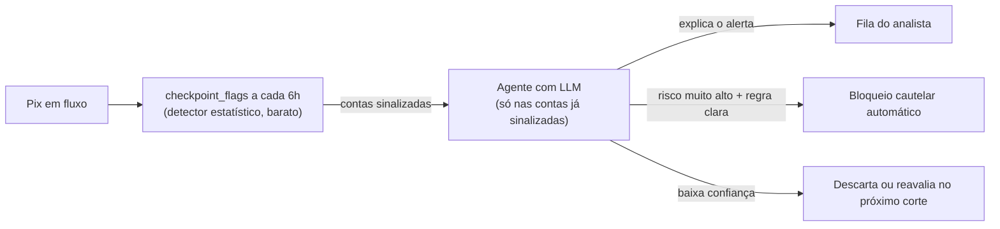

# IA agêntica para reconhecimento de fraude em tempo real

Volta para o [índice de ideias futuras](ideias-futuras.md).

Ideia original do autor da pesquisa: usar um agente de IA (com um LLM) para reconhecer
fraude **em tempo real**, não só em avaliação retrospectiva.

## O que existe hoje

A pesquisa já simula "tempo real" de um jeito específico:
[`pixfraud.online`](../../src/pixfraud/online.py) roda os detectores em pontos de corte
sucessivos (`checkpoint_flags`, a cada `freq`, por exemplo 6h), como um banco faria em
produção, e mede não só se uma conta fraudulenta é achada, mas **quando** — o que importa
porque o bloqueio cautelar do MED só retém dinheiro que ainda está na conta (ver
[`avaliar_deteccao_online.py`](../../scripts/mapa-dos-scripts.md) e a
[Figura 9](../../reports/mapa-dos-resultados.md) da lista de figuras). Isso já é
"detecção em tempo", mas com um detector estatístico (Isolation Forest, DBSCAN), sem
nenhum LLM ou agente envolvido.

## O que a ideia acrescentaria

Um agente de IA entraria como uma **camada sobre** esse pipeline, não no lugar dele — por
dois motivos práticos:

1. **Orçamento de tempo.** O Pix liquida em segundos. Chamar um LLM por transação, para
   decidir se ela é fraude, não cabe nesse orçamento (latência de um LLM generalista fica
   na casa de 1 a alguns segundos, e o custo por chamada multiplicado pelo volume de Pix
   do país é proibitivo). Os detectores estatísticos atuais continuam sendo a primeira
   linha, porque são baratos e rápidos o suficiente para rodar em cada checkpoint.
2. **O que o LLM faz bem que o detector não faz.** O detector devolve um escore; não
   explica em linguagem natural, não junta contexto de fora do grafo (por exemplo, o
   texto de uma denúncia, um padrão descrito por um analista) e não decide uma ação. Um
   agente entra depois do escore, só nas contas já sinalizadas, para: (a) explicar o
   motivo do alerta em linguagem natural, citando os atributos que mais pesaram (o
   heatmap de risco já calcula isso — ver [`docs/modelos.md`](../modelos.md) — falta só
   verbalizar); (b) cruzar com contexto adicional, se existir (reclamações, histórico de
   MED); (c) decidir a próxima ação (bloqueio automático, fila para analista, ignorar) com
   uma política auditável.

## Arquitetura, em linhas gerais

A escolha central é **onde** o LLM entra: como camada de explicação/triagem sobre um
detector estatístico que já filtrou o volume (a opção descrita acima, mais barata e mais
próxima do que a pesquisa já tem), ou como parte do próprio pipeline de streaming,
gerando um escore de anomalia direto do fluxo de transações. A segunda opção existe na
literatura recente — pipelines de streaming analytics com LLM para detecção de anomalias
financeiras em tempo real quase-instantâneo — mas ainda é mais cara e menos testada em
volume real:

- Kanikanti, Mula, Muthukumarasamy e outros, *Streaming analytics pipelines for
  LLM-based financial anomaly detection in Real-Time retail transaction flows*,
  International Journal of Information Technology, 2025 —
  <https://link.springer.com/article/10.1007/s41870-025-03107-6> (não fichado; autoria
  completa não conferida em detalhe, ver ressalva abaixo).
- *"It Warned Me Just at the Right Moment": Exploring LLM-based Real-time Detection of
  Phone Scams*, arXiv:2502.03964 — <https://arxiv.org/pdf/2502.03964> (mais próximo de
  golpe por engenharia social do que de fraude estrutural em grafo, mas relevante para a
  parte de "explicar o alerta para uma pessoa em tempo real").

> **Ressalva:** os dois links acima são achados de busca, citados informalmente (não
> entraram no `referencias.bib` nem em `docs/leituras/`) porque a autoria e os detalhes
> não foram conferidos com o mesmo cuidado que as 4 referências formais de
> [`docs/leituras/mapa-das-leituras.md`](../leituras/mapa-das-leituras.md#trabalhos-relacionados-fraude-com-redes-neurais-em-grafos).
> Se a ideia avançar, valem uma leitura e um fichamento de verdade antes de citar como
> fonte no relatório.

## Desafios em aberto

- **Auditabilidade.** Um banco precisa justificar o bloqueio cautelar conta a conta (ver
  a [ideia de explicabilidade para auditoria](explicabilidade-para-auditoria.md)); a
  explicação de um LLM precisa ser rastreável até os dados, não só plausível.
  Alucinação — o agente inventando um motivo que não está nos dados — é o risco central
  aqui, e uma explicação errada é pior do que nenhuma.
- **Custo em escala.** Mesmo só nas contas sinalizadas, o volume ainda é grande; caberia
  medir quantas contas chegam a essa camada por dia, no cenário mais realista da pesquisa
  ([`docs/resultados.md`](../resultados.md)), para estimar o custo de verdade.
- **Deriva do agente.** Um LLM por trás de uma API muda de versão sem aviso; um pipeline
  de decisão automatizada de bloqueio precisa de um jeito de perceber quando as
  explicações pioram, o que é um problema de avaliação contínua, não só de acurácia
  pontual.
- **Onde avaliar.** O mesmo arcabouço de `pixfraud.online` (recuperar dinheiro por prazo
  de saque) serviria para medir se a camada de agente muda o resultado final — atraso
  até a ação, dinheiro retido — e não só a qualidade da explicação isolada.
