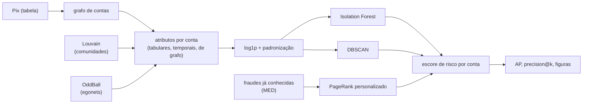

# Modelos usados na pesquisa (e outros que caberiam)

Este documento explica **o que cada modelo faz, por que ele está aqui e como está
configurado**. Os resultados de cada um estão em [resultados.md](resultados.md); os
parâmetros, em [`configs/experimento.yaml`](../configs/experimento.yaml).

As referências citadas estão em [`referencias.bib`](referencias.bib), com fichamento em
[`leituras/`](leituras/README.md).

A pesquisa é, por escolha da proposta, **não supervisionada**: o detector não vê rótulos.
Isso imita a situação real de um banco, em que a fraude só é conhecida depois (e em
parte), pelas contestações. Os modelos supervisionados que aparecem aqui servem de
**referência**, não de solução.

## Como as peças se encaixam

## 1. Preparação dos atributos

Antes de qualquer modelo, cada atributo passa por `log(1 + x)` e é padronizado
(`pixfraud.anomaly.prepare_matrix`).

* **Por que o log**: valores de Pix, graus e PageRank têm cauda muito pesada. Sem o log,
  uma única conta com R$ 1 milhão domina todas as distâncias.
* **Por que padronizar**: os dois detectores usam distância (o DBSCAN diretamente, o
  Isolation Forest ao escolher cortes); sem padronizar, o atributo de maior escala manda.
* **Consequência**: os atributos precisam ser não negativos. O código recusa valores
  negativos com mensagem explícita, em vez de deixar o `log1p` virar `NaN`.

## 2. Isolation Forest (não supervisionado)

**Ideia.** Sorteia um atributo e um corte ao acaso, muitas vezes, montando árvores. Uma
conta anômala fica isolada com **poucos cortes**, porque está longe das outras; o escore é
o inverso da profundidade média de isolamento (Liu, Ting e Zhou, 2008).

**Por que é adequado.** Não supõe formato de grupo (nem esférico, nem denso), lida bem com
muitos atributos e é rápido: 300 árvores em 2 mil contas levam menos de 1 segundo.

**Configuração** (`modelos.isolation_forest`): `n_estimators: 300` (mais árvores, menos
variação entre execuções), `contamination: auto` (não fixamos a fração esperada de
fraudes, que na prática não se conhece) e `seed`.

**Onde ele é melhor.** Nos conjuntos com muitos atributos estruturais
(`grafo_avancado`: AP 0,63) e nos temporais (0,57). Ele erra mais quando os atributos são
poucos e redundantes.

## 3. DBSCAN (não supervisionado)

**Ideia.** Agrupa pontos em regiões densas: uma conta é **núcleo** se tem ao menos
`min_samples` vizinhos dentro do raio `eps`; quem não é núcleo nem está perto de um é
**ruído**, e ruído é o que chamamos de anomalia (Ester et al., 1996).

**O escore.** O DBSCAN só devolve rótulos, não um escore contínuo. Usamos como escore a
**distância ao `min_samples`-ésimo vizinho** (k-distance), que é exatamente a grandeza que
define se a conta é núcleo. Assim conseguimos ordenar as contas e calcular average
precision e precision@k.

**Configuração** (`modelos.dbscan`):

| Parâmetro | Valor | Por quê |
|---|---|---|
| `min_samples` | 10 | quantos vizinhos definem "região densa" |
| `eps` | `auto` | escolhido pelo quantil das k-distances, para não depender da escala |
| `eps_quantile` | 0,95 | ~5% das contas ficam fora dos núcleos |
| `max_exact` | 20.000 | **até quantas contas gastar memória** com o rótulo exato (ver abaixo) |

**Memória.** O DBSCAN guarda a vizinhança de cada ponto. Com `eps` no quantil 0,95, cada
conta tem em média ~20% das contas por vizinha, então a memória cresce com o **quadrado**
do número de contas: 7 MB com 2.142 contas, ~4 GB com 50 mil, ~16 GB com 100 mil. Acima de
`max_exact`, o rótulo binário passa a ser "não é ponto de núcleo" (`k-distance > eps`),
que concorda com o DBSCAN em 97,6% das contas; o escore não muda, então **AP e
precision@k ficam idênticas**. Aumente `max_exact` se tiver RAM sobrando.

**Onde ele é melhor.** Com muitos atributos combinados (`completo`: AP 0,78 no cenário
base e 0,50 no realista), e é o melhor dos dois na maioria dos cenários.

## 4. Louvain e OddBall (dentro dos atributos)

Não são detectores, mas dois algoritmos de grafo que **produzem atributos**:

* **Louvain** (`pixfraud.communities`): encontra comunidades maximizando a modularidade.
  Dele sai o *coeficiente de participação*: quanto as ligações de uma conta se espalham
  por comunidades diferentes. As contas da quadrilha têm participação um pouco maior que
  as legítimas (efeito pequeno, delta de Cliff entre 0,26 e 0,43).
* **OddBall** (Akoglu, Tong e Koutra, 2015): em redes reais, o número de arestas e o valor
  movimentado na vizinhança de uma conta seguem leis de potência em função do número de
  vizinhos. O escore mede o quanto a conta **foge dessas leis**: vizinhança em estrela
  (vítimas que não se conhecem) ou dinheiro demais para o tamanho da vizinhança. Foi o
  atributo com maior efeito em todos os cenários.

## 5. PageRank personalizado, para "culpa por associação" (semi-supervisionado)

**Ideia.** Partindo das contas já conhecidas como fraudulentas (as contestações do MED),
um passeio aleatório que sempre volta para elas mede o quanto cada outra conta está
**perto** delas, e por quantos caminhos (Easley e Kleinberg, 2010). É o
`pixfraud.flow.propagate_risk`.

**Por que importa.** É o único modelo aqui que usa rótulos, e usa os que um banco já tem.
Combinado com o detector (média dos percentis), levou a average precision de 0,46 para
0,95 no cenário mais realista, com 25% das fraudes conhecidas.

## 6. Random Forest, como teto (supervisionado)

Serve só de referência: treinado **com os rótulos** (validação cruzada de 5 partes), mostra
até onde daria para chegar se eles existissem. Chega a AP 0,99 contra 0,53 do melhor não
supervisionado. A distância entre os dois é o custo de não ter rótulos, e é o que
justifica a seção anterior.

---

## Outros modelos que caberiam nesta pesquisa

Ordenados pelo que rende mais com o esforço que exigem. Todos entram pelo mesmo lugar:
uma função em [`anomaly.py`](../src/pixfraud/anomaly.py) que devolve `Detection` e uma
entrada em `DETECTORS`; as comparações e figuras funcionam sem mudança.

| Modelo | O que traria de novo | Esforço | Cuidado |
|---|---|---|---|
| **Local Outlier Factor (LOF)** | compara a densidade da conta com a dos vizinhos, em vez de usar um raio único; acha anomalias locais que o DBSCAN perde | baixo (scikit-learn) | mesma explosão de memória do DBSCAN em bases grandes |
| **ECOD / COPOD** | anomalia pela cauda da distribuição de cada atributo; não tem parâmetro para ajustar e é muito rápido | baixo (biblioteca PyOD) | ignora a relação entre atributos |
| **One-Class SVM** | fronteira não linear em volta do "normal" | baixo | custo cresce rápido com o nº de contas |
| **Autoencoder** | aprende a reconstruir contas normais; o erro de reconstrução vira o escore | médio (PyTorch) | precisa de mais dados e de ajuste; menos interpretável |
| **node2vec + detector** | transforma a vizinhança de cada conta num vetor aprendido, em vez de atributos escolhidos à mão | médio | o vetor não é interpretável, o que conflita com o objetivo de explicar |
| **GNN supervisionada (GraphSAGE, GAT, PNA)** | aprende os padrões de vizinhança direto do grafo; é o estado da arte em lavagem de dinheiro (Altman et al., 2023; Weber et al., 2019) | alto (PyTorch Geometric) | precisa de rótulos, GPU e cuidado com vazamento de informação |
| **FRAUDAR / subgrafo mais denso** | acha blocos suspeitos resistentes a camuflagem; já existe em `communities.densest_subgraph`, só falta avaliar | baixo (código pronto) | devolve um conjunto de contas, não um escore por conta |
| **Propagação de rótulos (label spreading)** | alternativa à propagação por PageRank, com rótulos positivos e negativos | baixo | precisa de exemplos negativos confiáveis |
| **Modelos de séries temporais por conta** (por exemplo, detecção de rajadas) | trata a sequência de Pix como sinal no tempo, em vez de agregados | médio | mais complexo de avaliar junto com o grafo |
| **Gradient boosting (XGBoost, LightGBM)** | teto supervisionado mais forte que o Random Forest | baixo | mesma limitação: depende de rótulos |

**Sugestão de ordem**, se for para acrescentar algum:

1. **ECOD ou LOF**: baratos, entram como mais uma coluna nas comparações que já existem e
   mostram se o DBSCAN está deixando algo na mesa.
2. **Avaliar o FRAUDAR** que já está implementado, medindo quantas contas da quadrilha
   caem no subgrafo mais denso.
3. **GNN**, como trabalho futuro do relatório: é o passo natural depois de mostrar que os
   atributos de grafo ajudam, mas exige rótulos e muda o caráter da pesquisa, que hoje é
   não supervisionada e interpretável.
