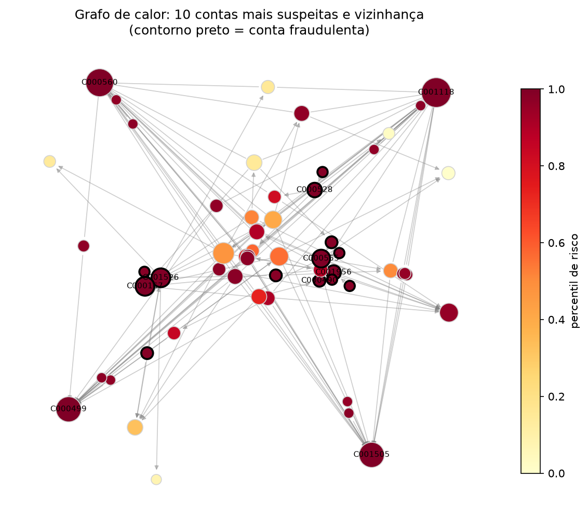
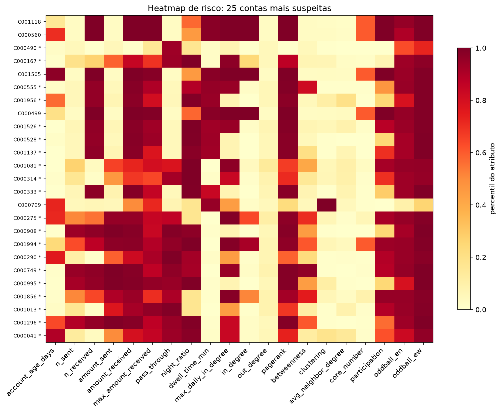
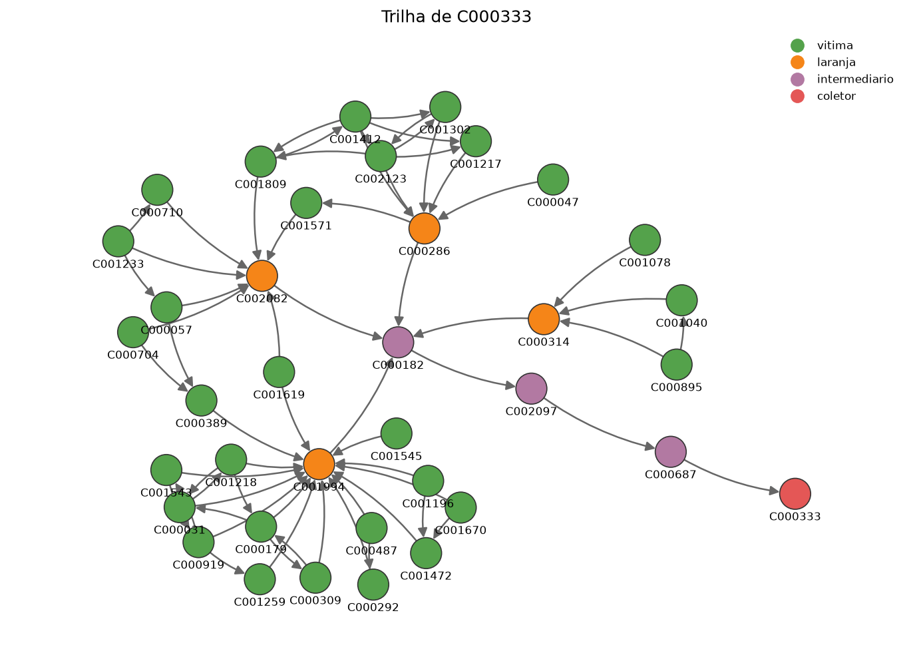

# A rede Pix dentro do cofre

O grafo do Obsidian mostra as **notas** e seus links. O grafo da **rede Pix** (contas e
transferências) é outra coisa: tem milhares de vértices e é desenhado pelos scripts do
projeto. Esta nota reúne as duas formas de olhar para ele sem sair do cofre.

Volta para o [índice da documentação](mapa-da-pesquisa.md).

## Rede inteira, interativa

A página abaixo tem todas as contas e Pix do dataset sintético, com busca, filtro por
papel, cor por papel, risco ou comunidade, e uma linha do tempo dia a dia. Ela é gerada
por [`scripts/visualizar_rede.py`](../scripts/visualizar_rede.py).

As contas das quadrilhas (laranjas, intermediários e coletoras) ficam juntas no **centro**,
uma quadrilha ao lado da outra, e os grupos de contas normais (Louvain) em volta. Assim o
dinheiro dos golpes aparece como setas convergindo das vítimas para o meio, em vez de
riscos cruzando a rede de um lado a outro.

As relações são **direcionadas**: cada seta vai de quem pagou para quem recebeu, e a
espessura cresce com o valor (o controle "Espessura das setas" aumenta todas). Na cor por
papel, o dinheiro da quadrilha leva a cor e o nome do **tipo de fluxo**, pelo papel de quem
pagou: golpe (vítima → laranja, verde), repasse da laranja (laranja), repasse do
intermediário (roxo) e saída da coletora (vermelho), mais saturados e grossos que o resto.

O controle **"Movimento normal"** regula a transparência de todo o Pix que não é da
quadrilha: à esquerda ele some (e as contas normais recuam para o fundo), à direita aparece
a rede inteira. Ao **passar o mouse** ou **clicar** numa conta, as entradas aparecem em azul
e as saídas em laranja; o clique esconde o resto, o mouse só o apaga.

<iframe src="../reports/estudos/rede_completa.html" width="100%" height="600" style="border:1px solid #c3c2b7;border-radius:6px"></iframe>

Se o quadro acima aparecer vazio (o Obsidian bloqueia páginas locais em algumas versões, e
o GitHub sempre remove quadros embutidos), abra o arquivo direto no navegador:
[rede_completa.html](../reports/estudos/rede_completa.html).

## Figuras estáticas

As contas mais suspeitas e sua vizinhança, coloridas pelo risco
([`rodar_experimento.py`](../scripts/rodar_experimento.py)):



Os atributos que explicam o risco de cada conta suspeita:



A trilha do dinheiro em volta de uma conta coletora, gerada por
[`criar_grafo.py`](../scripts/criar_grafo.py):



## Como gerar outros recortes

```powershell
python scripts/visualizar_rede.py --modelo isolation_forest --atributos grafo_avancado
python scripts/criar_grafo.py csv data/synthetic/transactions.csv --conta C000167 --saltos 2 --direcao tras --saida reports/estudos/trilha.png
```

O que cada arquivo contém está em [`reports/mapa-dos-resultados.md`](../reports/mapa-dos-resultados.md); a
interpretação, em [resultados](resultados.md).
