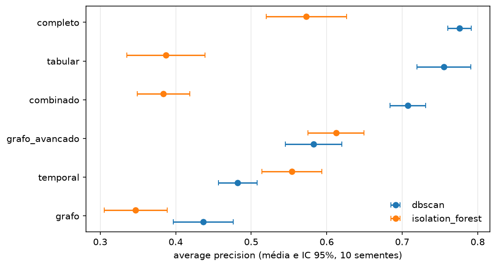
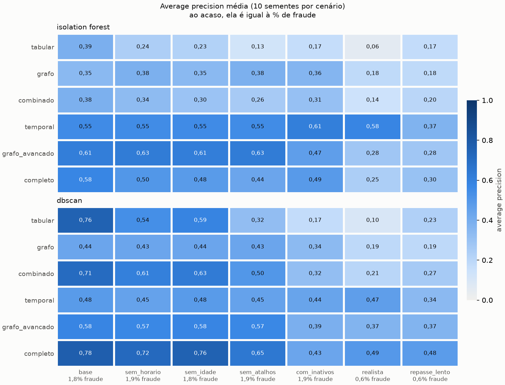
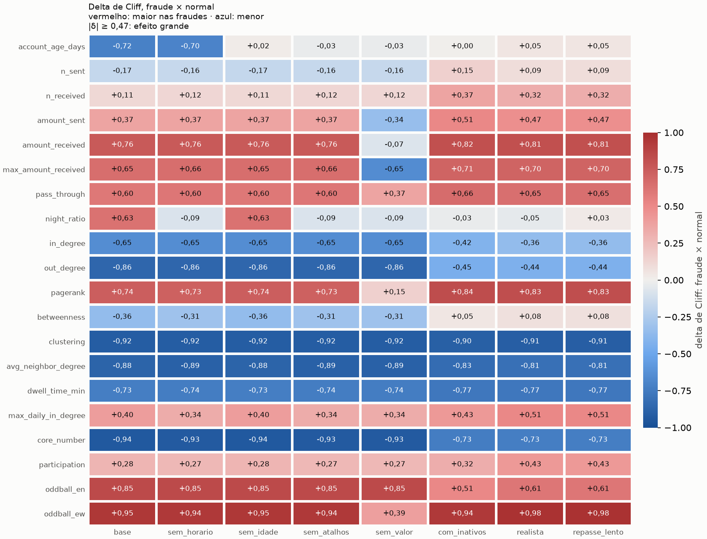
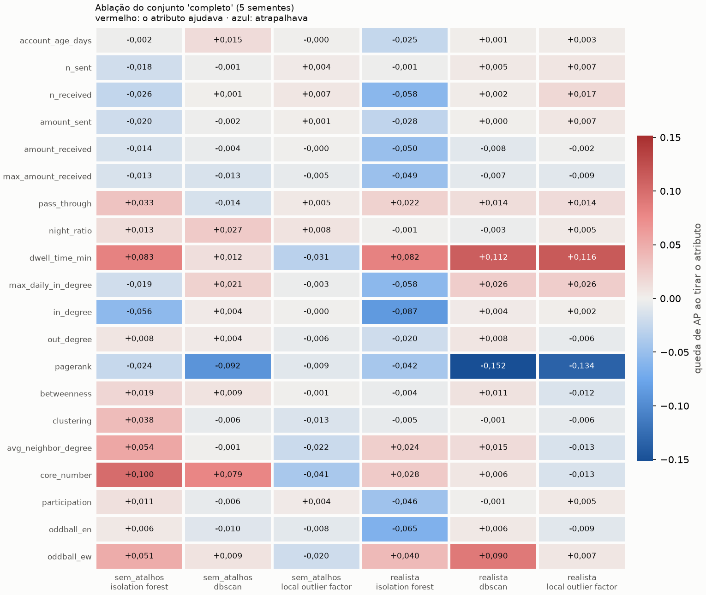
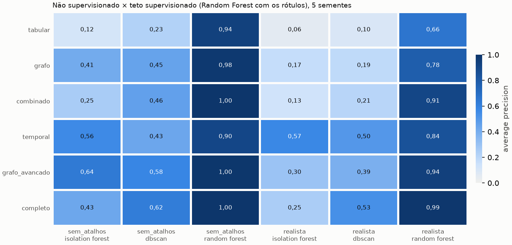
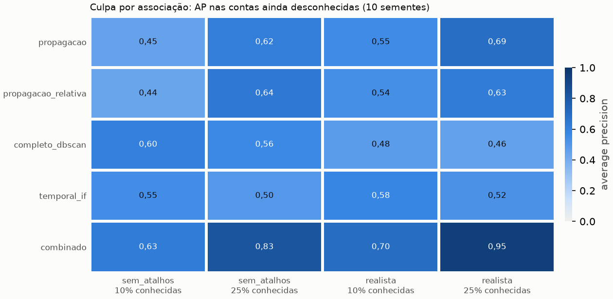
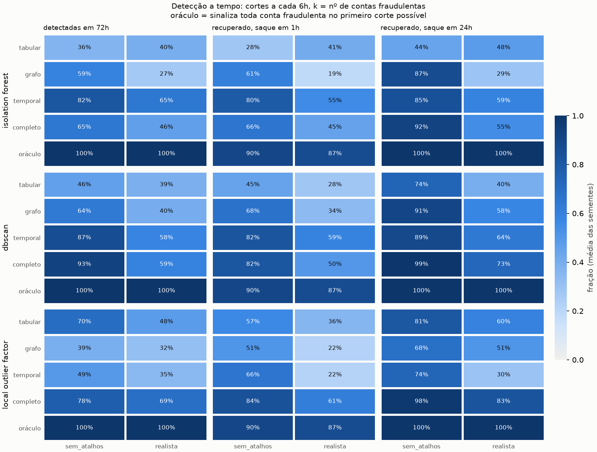
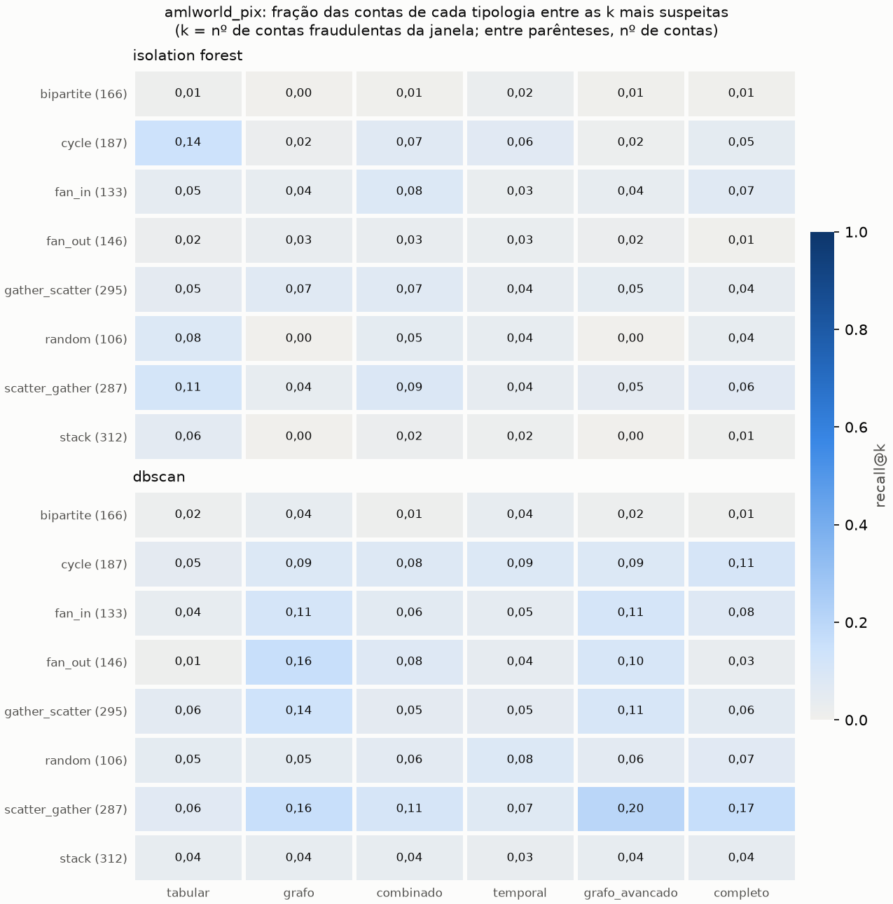
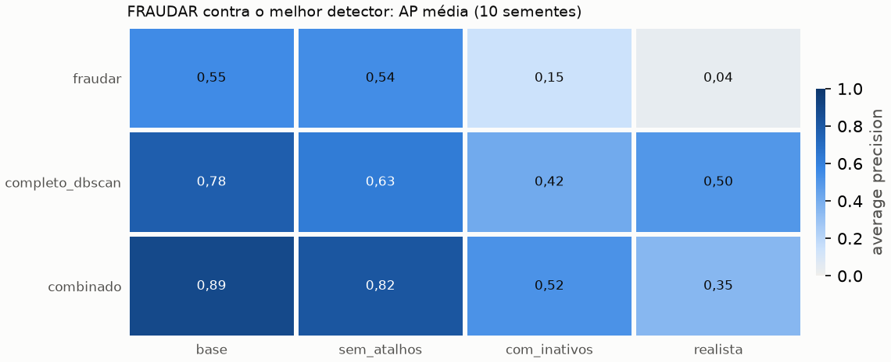

# Resultados gerados

Tudo aqui sai dos scripts de [`scripts/`](../scripts/mapa-dos-scripts.md) e pode ser refeito a
partir da configuração e das sementes. Os arquivos são pequenos e ficam versionados,
para os resultados aparecerem no GitHub e poderem ser citados por commit. A interpretação
está em [`docs/resultados.md`](../docs/resultados.md).

## `results/`: tabelas

| Arquivo | Script | Uma linha por... |
|---------|--------|------------------|
| `metricas.csv` | `rodar_experimento.py` | (conjunto de atributos, modelo), numa semente |
| `robustez_execucoes.csv` | `avaliar_robustez.py` | (semente, atributos, modelo) |
| `robustez_resumo.csv` | `avaliar_robustez.py` | (métrica, atributos, modelo): média e IC 95% |
| `robustez_comparacoes.csv` | `avaliar_robustez.py` | (métrica, modelo, par de conjuntos): teste pareado |
| `cenarios_execucoes.csv` | `avaliar_cenarios.py` | (cenário, semente, atributos, modelo) |
| `cenarios_resumo.csv` | `avaliar_cenarios.py` | (métrica, cenário, atributos, modelo) |
| `cenarios_comparacoes.csv` | `avaliar_cenarios.py` | (cenário, métrica, modelo, par de conjuntos) |
| `cenarios_efeitos.csv` | `avaliar_cenarios.py` | (cenário, atributo): delta de Cliff médio |
| `online_execucoes.csv`, `online_resumo.csv`, `online_comparacoes.csv` | `avaliar_deteccao_online.py` | (cenário, semente, atributos, modelo) e resumos |
| `online_cortes/` | `avaliar_deteccao_online.py` | contas sinalizadas em cada ponto de corte; **não versionado**, serve para retomar a execução |
| `atributos_ablacao.csv`, `atributos_ablacao_resumo.csv` | `avaliar_atributos.py` | (cenário, semente, modelo, atributo removido) e a queda média de AP |
| `atributos_teto.csv`, `atributos_teto_resumo.csv` | `avaliar_atributos.py` | AP dos detectores e do Random Forest supervisionado, por conjunto |
| `propagacao_execucoes.csv`, `propagacao_resumo.csv`, `propagacao_comparacoes.csv` | `avaliar_propagacao.py` | (cenário, semente, fração conhecida, método): AP nas contas ainda desconhecidas |
| `fraudar_execucoes.csv`, `fraudar_resumo.csv`, `fraudar_comparacoes.csv` | `avaliar_fraudar.py` | (cenário, semente, método): AP, precision@k, contas marcadas e cobertura das fraudes pelos blocos |
| `gnn_execucoes.csv`, `gnn_resumo.csv`, `gnn_comparacoes.csv` | `avaliar_gnn.py` | (cenário, semente, método): AP e precision@k das GNN, do DBSCAN e do Random Forest |
| `*_meta.json` | todos os scripts de avaliação | como o resultado foi gerado: commit, configuração, sementes, duração e versões |

### Colunas

| Coluna | Significado |
|--------|-------------|
| `atributos` | conjunto de atributos (`FEATURE_SETS` em `src/pixfraud/features.py`) |
| `modelo` | `isolation_forest` ou `dbscan` |
| `precision`, `recall`, `f1` | do rótulo binário do modelo (anomalia ou não) |
| `roc_auc`, `average_precision` | da ordenação pelo escore; a AP é a métrica principal (ao acaso, vale a taxa de fraude) |
| `precision_at_k` | fração de fraudes entre as *k* contas mais suspeitas (*k* = nº de fraudes) |
| `n_flagged` | quantas contas o modelo marcou como anômalas |
| `semente`, `cenario`, `fraudes`, `contas` | repetição, cenário de `configs/cenarios.yaml`, nº de contas fraudulentas e total |
| `mean`, `std`, `count`, `ic_inferior`, `ic_superior` | média, desvio, nº de repetições e IC t de 95% |
| `comparação` | `a - b`: diferença positiva quer dizer que `a` foi melhor |
| `diferença média`, `a vence em` | média de `a - b` nas repetições e em quantas `a` foi melhor |
| `p Wilcoxon`, `p t pareado`, `p Wilcoxon (Holm)` | p-valores; o último já corrigido para as várias comparações de cada métrica |
| `delta_medio`, `efeito` | delta de Cliff (fraude × normal; > 0 = maior nas fraudes) e rótulo do tamanho do efeito |
| `detectadas_72h`, `atraso_mediano_h` | fração das contas fraudulentas sinalizadas até 72 h após o 1º golpe e o atraso mediano |
| `recuperado_<prazo>` | fração do dinheiro roubado retida em contas bloqueadas, se o saque acontece após `<prazo>` |
| `atributo`, `ap_sem`, `ap_com_todos`, `queda` | atributo removido, AP sem ele, AP com todos e a diferença (> 0: o atributo ajudava) |
| `metodo`, `conhecidas` | método de pontuação (propagação, detector ou combinação) e fração das fraudes tratadas como já conhecidas |
| `fraudes_conhecidas`, `fraudes_restantes` | contas fraudulentas usadas como ponto de partida e as que ficaram para ser encontradas |

## `figures/`: figuras

| Arquivo | Script | Mostra |
|---------|--------|--------|
| `grafo_de_calor_<modelo>_<atributos>.png` | `rodar_experimento.py` | as contas mais suspeitas e sua vizinhança, coloridas pelo risco |
| `heatmap_risco_<modelo>_<atributos>.png` | `rodar_experimento.py` | os atributos que explicam o risco de cada conta suspeita |
| `robustez_average_precision.png` | `avaliar_robustez.py` | AP média e IC 95% por conjunto e modelo |
| `cenarios_average_precision.png` | `avaliar_cenarios.py` | AP média por conjunto × cenário |
| `cenarios_efeitos.png` | `avaliar_cenarios.py` | delta de Cliff de cada atributo × cenário |
| `online_deteccao.png` | `avaliar_deteccao_online.py` | detectadas em 72 h e dinheiro recuperado |
| `atributos_ablacao.png` | `avaliar_atributos.py` | queda de AP ao tirar cada atributo |
| `atributos_teto.png` | `avaliar_atributos.py` | detectores não supervisionados × Random Forest com os rótulos |
| `propagacao_average_precision.png` | `avaliar_propagacao.py` | AP da propagação de risco, dos detectores e da combinação |
| `fraudar_average_precision.png` | `avaliar_fraudar.py` | AP do FRAUDAR, do DBSCAN e da combinação por cenário |
| `gnn_average_precision.png` | `avaliar_gnn.py` | AP das GNN e das referências por cenário |
| `padroes_de_fraude.png`, `quadrilha.gif`, `rede_exemplo.png` | `gerar_ilustracoes.py` | ilustrações do README: os padrões injetados, o dinheiro percorrendo a quadrilha e a fraude dentro do movimento normal |
| `grafo_de_notas.png`, `grafo_do_codigo.png` | `ilustrar_grafos_de_conhecimento.py` | ilustrações do README: o grafo de notas do Obsidian e o mapa do código pelo Graphify (não são resultados da pesquisa) |

## `amlworld/`: validação externa

Saída de `avaliar_externo.py` sobre o AMLworld (ver [`data/README.md`](../data/README.md)):
`results/<dataset>_execucoes.csv`, `_resumo.csv`, `_comparacoes.csv` e `_tipologias.csv`
(recall@k por tipologia de lavagem), além de `<dataset>_janelas/` (cada janela salva, **não versionada**) e
`figures/<dataset>_tipologias.png`. O `<dataset>` é `amlworld_pix` (só ACH e Wire) ou
`amlworld` (todas as formas de pagamento).

## `estudos/`: grafos dos estudos

Saídas de `criar_grafo.py` e de `visualizar_rede.py` (`rede_completa.html`: a rede
inteira; abra no navegador). São material de estudo, não resultados da pesquisa.

## Lista de figuras

Galeria na ordem em que a pesquisa é contada, no estilo de uma lista de figuras de TCC.
Os arquivos ficam versionados em `figures/` e `amlworld/figures/`, e podem ser refeitos a
partir da configuração e das sementes (ver o `*_meta.json` de cada script, na tabela
acima). A interpretação de cada uma está em [`docs/resultados.md`](../docs/resultados.md).

**Figura 1** — Os padrões de fraude injetados pelo simulador (conta laranja,
intermediário, coletora), separados por papel.
*Fonte: `gerar_ilustracoes.py`.*

**Figura 2** — Uma quadrilha dentro do movimento normal: o que a denuncia não é o que
cada conta faz sozinha, e sim o formato que desenha na rede.
*Fonte: `gerar_ilustracoes.py`.*

**Figura 3** — Average precision média e intervalo de confiança de 95%, por conjunto de
atributos e modelo, em 10 sementes.
*Fonte: `avaliar_robustez.py`.*

**Figura 4** — Average precision média por conjunto de atributos × cenário (fácil, base,
difícil, realista).
*Fonte: `avaliar_cenarios.py`.*

**Figura 5** — Delta de Cliff de cada atributo, fraude × normal, em cada cenário: o
tamanho do efeito que separa as duas classes.
*Fonte: `avaliar_cenarios.py`.*

**Figura 6** — Queda de average precision ao remover cada atributo, um de cada vez
(ablação).
*Fonte: `avaliar_atributos.py`.*

**Figura 7** — Os detectores não supervisionados contra o teto do Random Forest treinado
com os rótulos: a distância entre os dois é o custo de não ter rótulos.
*Fonte: `avaliar_atributos.py`.*

**Figura 8** — Average precision da propagação de risco (PageRank personalizado a partir
de fraudes já conhecidas), dos detectores sozinhos e da combinação dos dois.
*Fonte: `avaliar_propagacao.py`.*

**Figura 9** — Fração das contas fraudulentas detectadas até 72 h após o primeiro golpe e
fração do dinheiro roubado retida, simulando o bloqueio cautelar (MED).
*Fonte: `avaliar_deteccao_online.py`.*

**Figura 10** — Grafo de calor: as contas mais suspeitas e sua vizinhança, coloridas pelo
risco (DBSCAN, conjunto de atributos completo). As demais combinações de modelo ×
conjunto de atributos seguem o mesmo padrão e ficam em `grafo_de_calor_<modelo>_<atributos>.png`.
*Fonte: `rodar_experimento.py`.*

**Figura 11** — Heatmap de risco: os atributos que explicam o risco de cada conta
suspeita (DBSCAN, conjunto completo). As demais combinações ficam em
`heatmap_risco_<modelo>_<atributos>.png`.
*Fonte: `rodar_experimento.py`.*

**Figura 12** — Recall@k por tipologia de lavagem de dinheiro, na validação externa com o
AMLworld (versão só com ACH e Wire, mais próxima do Pix).
*Fonte: `avaliar_externo.py`.*

**Figura 13** — Average precision do FRAUDAR (blocos densos, só estrutura), do melhor
detector de atributos e da combinação dos dois, do cenário mais fácil ao mais realista.
*Fonte: `avaliar_fraudar.py`.*

**Figura 14** — Average precision das redes neurais para grafos (DOMINANT, sem rótulos;
GraphSAGE, com rótulos) ao lado do DBSCAN e do Random Forest.
*Fonte: `avaliar_gnn.py`.*

## Material interativo

Não são figuras estáticas, então ficam fora da lista numerada acima:

- [`quadrilha.gif`](figures/quadrilha.gif): o dinheiro percorrendo a quadrilha, do golpe
  ao saque.
- [`estudos/rede_completa.html`](estudos/rede_completa.html): toda a rede sintética, com
  busca, filtro por papel, cor por papel/risco/comunidade, setas no sentido do dinheiro
  (entradas e saídas destacadas ao clicar numa conta) e linha do tempo dia a dia
  (embutida em [`docs/rede-pix.md`](../docs/rede-pix.md)).
- [`estudos/trilha_coletor.png`](estudos/trilha_coletor.png): a trilha do dinheiro em
  volta de uma conta coletora (`criar_grafo.py`), usada também em `docs/rede-pix.md`.
